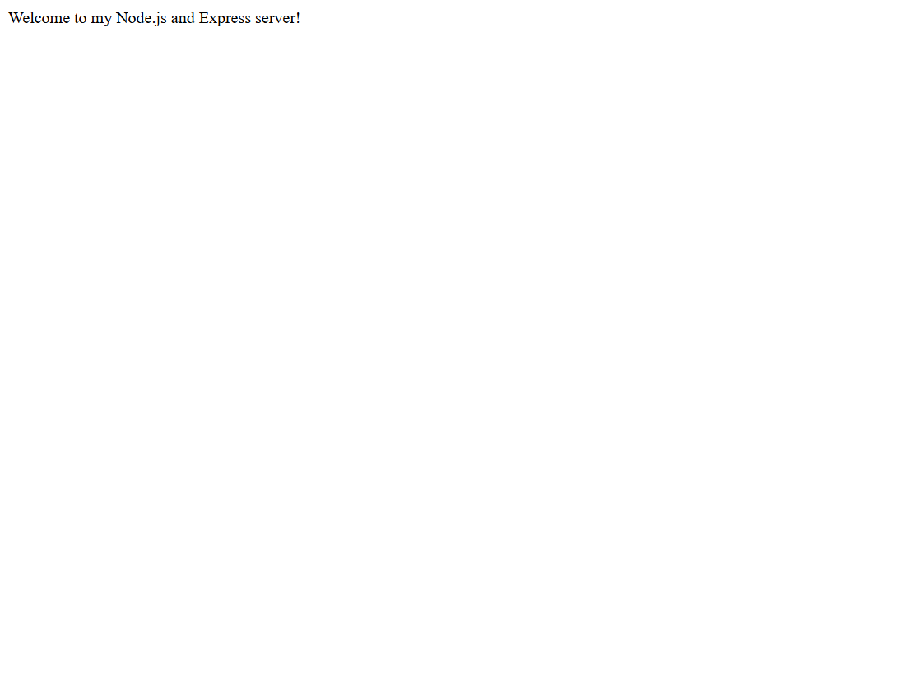
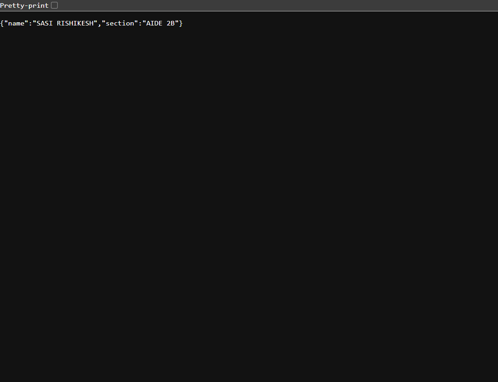
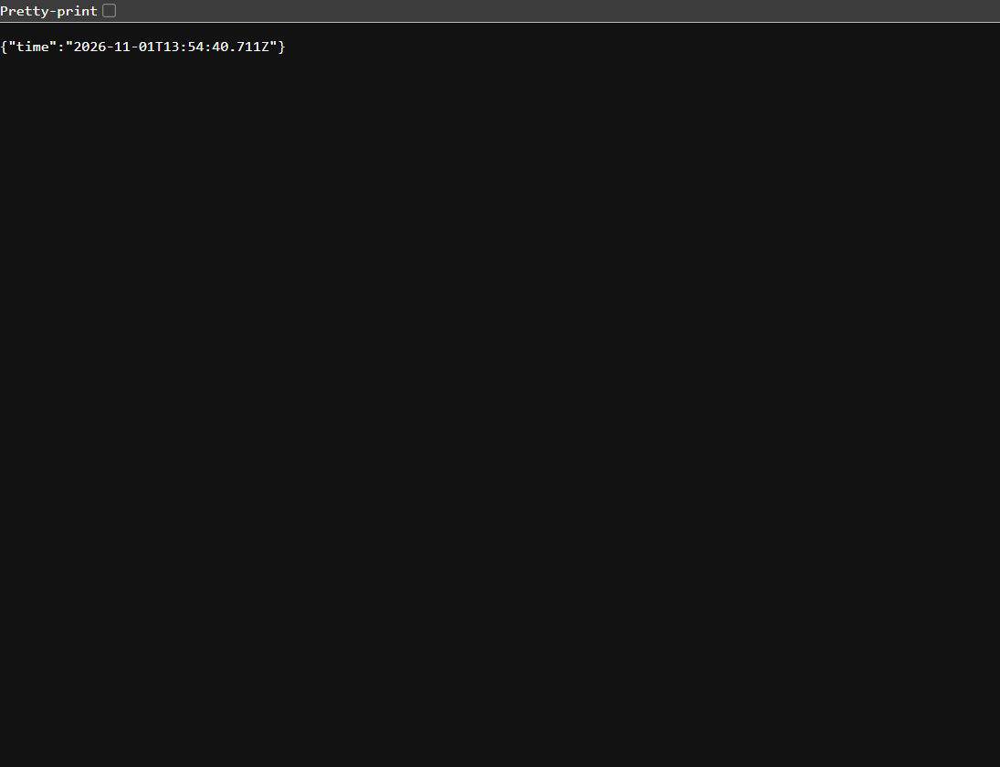

# Lab 1: Node.js and Express server

**Name:** SASI RISHIKESH

**Registration number:** 252U1R5091

**Section:** AIDE 2B

## Live link

Not deployed. This project currently runs locally; add the public deployment URL here after deploying it to Render, Railway, or another hosting service.

## Objective

Create a basic web server with Node.js's built-in `http` module, then build the same kind of server with Express and add routes with appropriate status codes.

## How to install and run

Requirements: Node.js and npm. No environment variables are required. The server uses `PORT` if provided; otherwise it listens on port `3000`.

From this folder, install dependencies:

```bash
npm install
```

Start the Express server:

```bash
npm start
```

To run the built-in HTTP server instead, stop the Express server with `Ctrl+C`, then run:

```bash
npm run start:http
```

Both servers listen on the same port, so run only one at a time. Open the route URLs below in a browser. To verify the exact HTTP status code, use the browser's Developer Tools **Network** panel and inspect each request.

## Endpoints

| Method | Path | Description | Status |
|---|---|---|---:|
| GET | `/` | Returns a welcome message. | 200 |
| GET | `/about` | Returns the student's name and section as JSON. | 200 |
| GET | `/time` | Returns the current date and time as JSON. | 200 |
| Any | Any unknown path | Returns `404 - Page Not Found`. | 404 |

## `package.json` fields

- **name**: The project/package name.
- **version**: The current project version.
- **description**: A short explanation of the project.
- **main**: The main entry point (`server.js`).
- **scripts**: Named commands that npm can run, including `npm start` and `npm run start:http`.
- **keywords**: Search terms describing the project.
- **author**: The package author's name; fill this in if required.
- **license**: The license identifier (`ISC`).
- **type**: `commonjs` means this project uses CommonJS `require()` syntax.
- **dependencies**: Packages needed by the project. Express is recorded here so `npm install` can install it.

`package.json` records project metadata and dependency requirements. `node_modules/` contains the installed package files and can be recreated with `npm install`, so it is excluded from Git.

## Screenshots

Save screenshots of the three successful routes in `screenshots/` and keep these links in sync with their filenames:








## Notes / problems faced

- The plain HTTP and Express examples both use port 3000; stop one before starting the other.
- If port 3000 is already occupied, stop the other process or set the `PORT` environment variable to an available port.
- If Express is not found, run `npm install` in this folder.

## Viva preparation

**What is the difference between `package.json` and `node_modules`?**

`package.json` describes the project and its dependencies. `node_modules` contains the actual installed package code.

**What does `app.listen()` do?**

It starts the Express server and makes it listen for incoming requests on the specified port.

**What do request and response represent?**

The request contains information sent by the client to the server. The response is what the server sends back to the client, including a status code and content.
